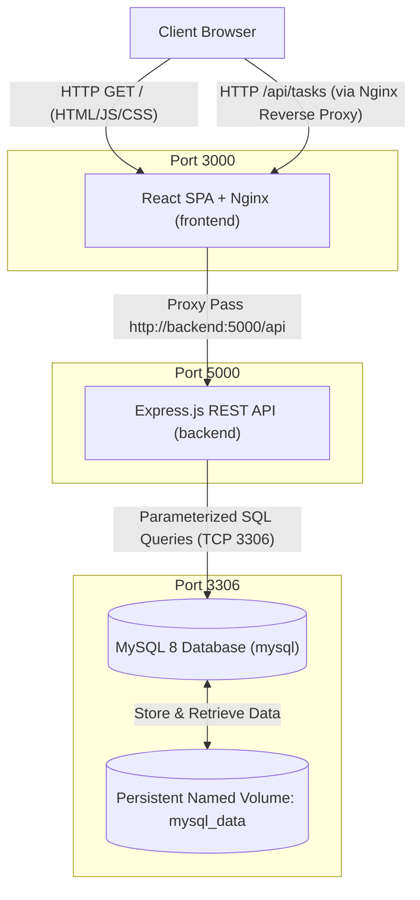

# TaskMaster Pro - Full-Stack Three-Tier Application

A production-grade, containerized Three-Tier Task Management Web Application built with **React (Vite)**, **Node.js (Express)**, and **MySQL 8**, orchestrated with **Docker** and **Docker Compose**.

---

## Architecture Diagram



---

## Technology Stack

| Layer | Technology | Version | Purpose |
| :--- | :--- | :--- | :--- |
| **Frontend** | React.js + Vite | React 18 / Vite 6 | Fast SPA user interface, hooks, responsive glassmorphism |
| **Frontend Server** | Nginx Alpine | Alpine | Serves production build and acts as API reverse proxy |
| **Backend** | Node.js + Express | Node 20 / Express 4 | RESTful API service, input validation, CORS handling |
| **Database Driver**| `mysql2` | 3.12+ | Parameterized SQL queries, connection pool management |
| **Database** | MySQL Server | 8.0 | Relational ACID database with persistent named volume |
| **Orchestration** | Docker & Docker Compose | Compose v2+ | Multi-container lifecycle, networking, health probes |

---

## Directory Structure

```
fullstack-docker-project/
├── frontend/                     # React Single Page Application (Presentation Tier)
│   ├── public/                   # Static assets (Favicon, icons)
│   │   └── favicon.svg
│   ├── src/
│   │   ├── components/           # Reusable UI components
│   │   │   ├── Navbar.jsx        # Top navigation with live system health badge
│   │   │   ├── DashboardStats.jsx# Summary counters (Total, Pending, Progress, Completed)
│   │   │   ├── TaskCard.jsx      # Task item card with quick status dropdown & actions
│   │   │   ├── TaskFormModal.jsx # Add / Edit task modal form with validation
│   │   │   ├── DeleteConfirmModal.jsx # Confirmation modal to prevent accidental deletion
│   │   │   └── Toast.jsx         # Non-blocking notification popups
│   │   ├── pages/
│   │   │   └── TaskDashboard.jsx # Main view aggregating stats, search, filters & cards
│   │   ├── services/
│   │   │   └── api.js            # Axios client with uniform error interceptor
│   │   ├── App.jsx               # Application root component
│   │   ├── index.css             # Vanilla CSS design tokens & animations
│   │   └── main.jsx              # React DOM render entry point
│   ├── index.html                # HTML5 template with SEO meta tags
│   ├── nginx.conf                # Nginx production configuration & API reverse proxy
│   ├── vite.config.js            # Vite build and development proxy configuration
│   ├── package.json              # Frontend dependencies and build scripts
│   ├── .dockerignore             # Excludes node_modules and logs from Docker context
│   └── Dockerfile                # Multi-stage Dockerfile (Node build -> Nginx Alpine)
│
├── backend/                      # Node.js + Express REST API (Application Tier)
│   ├── config/
│   │   └── db.js                 # MySQL connection pool configuration (mysql2/promise)
│   ├── controllers/
│   │   └── taskController.js     # CRUD business logic with parameterized SQL queries
│   ├── routes/
│   │   └── taskRoutes.js         # API route endpoints definition
│   ├── middleware/
│   │   ├── validateTask.js       # Request payload validation middleware
│   │   └── errorHandler.js       # Centralized 404 & 500 error handler
│   ├── server.js                 # Express server initialization & graceful shutdown
│   ├── package.json              # Backend dependencies and scripts
│   ├── .env.example              # Sample environment configuration
│   ├── .dockerignore             # Excludes node_modules from Docker context
│   └── Dockerfile                # Production Node 20 Alpine container with non-root user
│
├── database/                     # MySQL Database Tier (Data Tier)
│   └── init.sql                  # Database schema DDL & initial seed records
│
├── docker-compose.yml            # Multi-container orchestration specification
├── .env.example                  # Root environment variables template
├── .gitignore                    # Git version control exclusions
└── README.md                     # Comprehensive project documentation
```

---

## REST API Specification

### Health Check
- **Endpoint**: `GET /api/health`
- **Description**: Verifies backend process and executes `SELECT 1` on MySQL.
- **Success Response (`200 OK`)**:
  ```json
  {
    "status": "UP",
    "database": "connected",
    "timestamp": "2026-11-02T11:15:00.000Z",
    "uptimeSeconds": 128.4
  }
  ```

### Task CRUD Endpoints

| Method | Endpoint | Query / Body Parameters | Description |
| :--- | :--- | :--- | :--- |
| `GET` | `/api/tasks` | `?search=&status=&priority=` | List tasks with optional keyword search and status/priority filters |
| `GET` | `/api/tasks/:id` | None | Fetch a single task by ID |
| `POST` | `/api/tasks` | `{ title, description, status, priority }` | Create a new task (validates required fields) |
| `PUT` | `/api/tasks/:id` | `{ title, description, status, priority }` | Update existing task attributes |
| `DELETE` | `/api/tasks/:id` | None | Delete a task by ID |

---

## Local Execution (Without Docker)

### Prerequisites
- **Node.js**: v18.0.0 or higher (`node -v`)
- **npm**: v9.0.0 or higher (`npm -v`)
- **MySQL Server**: v8.0 or higher running locally on port 3306

### Step 1: Initialize Database
Open MySQL command prompt or workbench and execute:
```bash
mysql -u root -p < database/init.sql
```
Verify table creation:
```sql
USE task_management;
SHOW TABLES;
SELECT * FROM tasks;
```

### Step 2: Configure & Start Backend
1. Navigate to the backend directory:
   ```bash
   cd backend
   ```
2. Copy `.env.example` to `.env`:
   ```bash
   cp .env.example .env
   ```
   *(On Windows PowerShell: `Copy-Item .env.example .env`)*
3. Edit `backend/.env` with your local MySQL credentials:
   ```env
   PORT=5000
   DB_HOST=localhost
   DB_USER=root
   DB_PASSWORD=your_mysql_password
   DB_NAME=task_management
   DB_PORT=3306
   CORS_ORIGIN=http://localhost:3000
   ```
4. Install dependencies and start server:
   ```bash
   npm install
   npm run dev
   ```
5. Verify API in browser: [http://localhost:5000/api/health](http://localhost:5000/api/health)

### Step 3: Configure & Start Frontend
1. Open a new terminal and navigate to the frontend directory:
   ```bash
   cd frontend
   ```
2. Copy `.env.example` to `.env`:
   ```bash
   cp .env.example .env
   ```
3. Install dependencies and start Vite dev server:
   ```bash
   npm install
   npm run dev
   ```
4. Access the application in your browser: [http://localhost:3000](http://localhost:3000)

---

## Docker Containerization & Docker Compose

### Prerequisites
- Docker Engine 24+ (`docker --version`)
- Docker Compose v2+ (`docker compose version`)

### Quick Start Commands

```bash
# 1. Copy root environment template
cp .env.example .env

# 2. Build images for all services
docker compose build

# 3. Start all services in detached mode
docker compose up -d

# 4. Check service status and health probes
docker compose ps

# 5. Follow live logs
docker compose logs -f

# 6. Stop all containers (preserving persistent database data)
docker compose stop

# 7. Restart stopped containers
docker compose start

# 8. Teardown containers and network
docker compose down

# 9. Teardown containers AND delete MySQL volume (WARNING: deletes all database records)
docker compose down -v
```

---

## Port Mappings in Docker
- **Frontend**: [http://localhost:3000](http://localhost:3000)
- **Backend**: [http://localhost:5000](http://localhost:5000)
- **MySQL Database**: `localhost:3306`

---

## Docker Networking & Storage Deep-Dive

### Docker Network
- All three containers join the isolated bridge network `task_management_network`.
- Containers resolve each other using Docker internal DNS via service names:
  - Backend connects to MySQL using hostname `mysql:3306` instead of `localhost`.
  - Nginx connects to backend using hostname `backend:5000`.

### Docker Volume
- MySQL stores table files in `/var/lib/mysql`.
- The named volume `task_management_mysql_data` maps this directory on the host.
- Stopping or recreating containers via `docker compose down` retains all inserted tasks. Data is only wiped when explicitly executing `docker compose down -v`.

---

## Troubleshooting Guide

| Issue | Root Cause | Solution |
| :--- | :--- | :--- |
| **Docker daemon not running** | Docker Desktop is closed or service stopped | Launch Docker Desktop or run `net start com.docker.service` |
| **Port 3306 or 5000 in use** | A local MySQL or Node process is already running | Stop local MySQL service (`Stop-Service MySQL80`) or adjust ports in `docker-compose.yml` |
| **MySQL connection refused** | Backend started before MySQL was ready | Docker Compose `healthcheck` with `depends_on: mysql: condition: service_healthy` prevents this |
| **Access denied for MySQL user** | Password mismatch in `.env` | Ensure `MYSQL_ROOT_PASSWORD` and `MYSQL_PASSWORD` in `.env` match backend credentials |
| **CORS errors in browser** | Mismatched origin | In Docker, Nginx proxies `/api` requests directly to backend, completely bypassing browser CORS restrictions |
| **Database initialization script didn't run** | Existing volume data detected | MySQL only runs `/docker-entrypoint-initdb.d/` on empty data directories. Reset volume using `docker compose down -v` |
